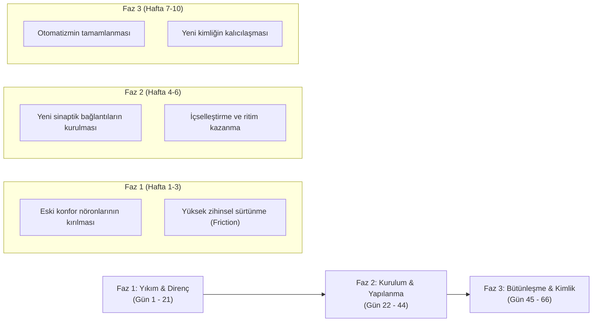
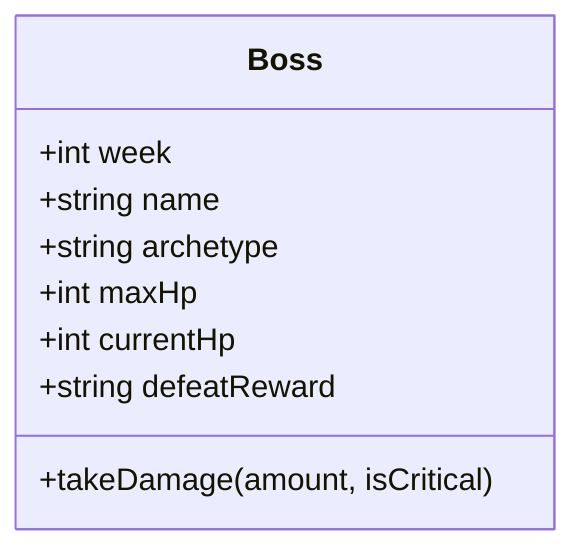

# Life Reset: 66 Day Habit (Rise) — Kapsamlı Tersine Mühendislik & Android RYO Mimarisi

Bu doküman; **Life Reset: 66 Day Habit** (Google Play Paket Kimliği: `build.designand.riselife`, eski adıyla **Rise**) uygulamasının ürün anatomisi, psikolojik bağlanma algoritmaları, nöroplastisite oyun döngüsü ve F-Droid / GitHub standartlarında açık kaynaklı **Reset66 Android APK** uygulamasının mimari şartnamesidir.

---

## 1. Orijinal Uygulamanın Ürün Anatomisi & Tersine Mühendisliği

### 1.1. Ürün Kimliği & Teknik Künye
* **Uygulama Adı:** Life Reset: 66 Day Habit (Eski adı: *Rise: Life Reset in 66 Days*)
* **Geliştirici / Yayıncı:** Design and Build (Google Play) / Savvy Tech Limited (Apple App Store)
* **Paket (Bundle ID):** `build.designand.riselife` (Android) / `build.designand.rise` (iOS)
* **Kategori:** Sağlık & Fitness / Alışkanlık Takibi & Oyunlaştırma (Habit-RPG)
* **Kullanıcı Kitlesi:** 1.5 Milyondan fazla indirme, küresel kullanıcı tabanı

### 1.2. Kullanıcı Edinme Hunisi (Onboarding Funnel) & Psikolojik Bağlanma
Orijinal uygulamanın yüksek dönüşüm ve tutundurma oranının arkasında 10 dakikalık derin bir kurulum testi yer alır:
1. **Mikro-Taahhüt (Micro-Commitment) Testi:** Kullanıcıya uyku, odaklanma süresi, enerji dalgalanmaları ve erteleme alışkanlıkları sorulur.
2. **Kişiselleştirilmiş İllüzyon:** Sistem arka planda "Yapay zeka zayıflık profilinizi analiz ediyor..." animasyonu göstererek kullanıcıya özel bir nöroplastisite haritası oluşturulduğu hissini verir.
3. **Kaybetme Korkusu (Loss Aversion):** Testin sonunda "Eğer mevcut alışkanlıklarınızı değiştirmezseniz 5 yıl sonraki potansiyeliniz %68 oranında körelecek" gibi sert psikolojik grafikler sunulur.
4. **Hard Paywall:** Kullanıcı tam alışkanlıklarını görmek istediğinde haftalık veya yıllık abonelik duvarı ile karşılaşır.

**Reset66 Farkı:** Reset66, bu psikolojik modeli tamamen açık kaynaklı, reklamsız, sunucusuz ve F-Droid / GitHub üzerinden ücretsiz derlenebilir hale getirerek kullanıcıya tam veri mahremiyeti ve bağımsızlık sağlar.

---

## 2. Oyunlaştırma (Gamification) & Matematiksel İlerleme Algoritması

### 2.1. UCL 66 Günlük Nöroplastisite Modeli
Londra Üniversitesi Koleji'nden (UCL) Dr. Phillippa Lally ve ekibinin yaptığı ampirik araştırmaya göre, yeni bir davranışın beyinde otomatik bir nöral patika (otomatizm) haline gelmesi ortalama **66 gün** sürer.

Reset66 bu 66 günlük süreci 3 ana evreye ve 10 haftalık zindan sistemine böler:



### 2.2. Kademeli Yükleme (Progressive Overload) Formülleri
Her hafta ($w = 0, 1, 2, \dots, 9$), görev hedefleri doğrusal ve güvenli artış fonksiyonlarına göre hesaplanır:

1. **Erken Uyanış (Disiplin):**
   $$T_{\text{sleep}}(w) = \max\left(330, T_{\text{base}} - w \times 10\right) \quad (\text{dakika cinsinden gün başlangıcı})$$
2. **Su Tüketimi (Dayanıklılık / VIT):**
   $$\text{Water}(w) = \text{Base}_{\text{water}} + (w \times 150) \text{ ml}$$
3. **Egzersiz Süresi (Güç / STR):**
   $$\text{Exercise}(w) = \text{Base}_{\text{ex}} + (w \times 5) \text{ dakika}$$
4. **Zihin & Meditasyon (Zihin / MND):**
   $$\text{Mind}(w) = \text{Base}_{\text{mind}} + (w \times 3) \text{ sayfa/seans}$$
5. **Sosyal Medya Limiti (Odak / FOC):**
   $$\text{Screen}(w) = \max\left(15, \text{Base}_{\text{screen}} - (w \times 5)\right) \text{ dakika}$$
6. **Soğuk Duş (İrade / WIL):**
   $$\text{ColdShower}(w) = \text{Base}_{\text{shower}} + (w \times 15) \text{ saniye}$$

---

## 3. 6 Yaşam Sütunu (Core Life Pillars) & Nitelik Sistemi

Kullanıcının karakter istatistikleri doğrudan 6 sütun üzerinden şekillenir:

| Sütun Kodu | Sütun Adı | Gerçek Hayat Eylemi | RPG Rolü & Stat Katkısı |
|:---:|:---|:---|:---|
| **STR** | Güç & Kuvvet | Antrenman, Ağırlık / Calisthenics | Fiziksel Hasar Çarpanı |
| **VIT** | Canlılık & Dayanıklılık | Hücresel Hidrasyon, Uyku Kalitesi | Maksimum HP & Yenilenme |
| **MND** | Zihin & Bilgelik | Kitap Okuma, Nefes & Meditasyon | Odak & Zihinsel Hasar |
| **WIL** | İrade & Direnç | Soğuk Duş, Konforu Reddetme | Kritik Vuruş Şansı |
| **FOC** | Odak & Derin Çalışma | Ekran Süresi Kısıtlama, Pomodoro | Boss Yetenek Engelleme |
| **DIS** | Disiplin & Süreklilik | Erken Uyanış, Rutin Devamlılığı | Seri (Streak) Koruması |

---

## 4. 10 Haftalık Gölge Boss Zindanları (Shadow Bosses)

Kullanıcının zihnindeki içsel engeller ve bilişsel yanılgılar haftalık Boss patronları olarak canlandırılır:



| Hafta | Patron Adı | Psikolojik Arketip | Başlangıç HP | Boss Zafer Ödülü |
|:---:|:---|:---|:---:|:---|
| **1** | Atalet Gölgesi | Eylemsizlik, yatakta kalma isteği | 300 HP | "İlk Kıvılcım" Başarımı |
| **2** | Erteleme İblisi | "Yarın başlarım" aldatmacası | 450 HP | +50 Bonus Deneyim |
| **3** | Ucuz Dopamin Ejderi | Sürekli bildirim ve kısa video bağımlılığı | 600 HP | Odak Rozeti (FOC +5) |
| **4** | Konfor Alanı Gardiyanı | Zorluktan ve soğuktan kaçış | 800 HP | İrade Zırhı (WIL +6) |
| **5** | Dağınık Zihin Hayaleti | Odaklanamama ve beyin sisi | 1050 HP | Berraklık Madalyonu |
| **6** | Şüphe Lordu | "Başaramayacağım" sendromu | 1350 HP | İnanç Kılıcı |
| **7** | Bahane Golemi | Mantığa büründürülmüş tembellik | 1700 HP | Sarsılmaz Taş Unvanı |
| **8** | Uykusuzluk Canavarı | Gece ekranına bakıp ritmi bozma | 2100 HP | Gece Kalkanı (VIT +8) |
| **9** | Kaos Şövalyesi | Beklenmedik krizlerde rutini terk etme | 2600 HP | Düzen Asası |
| **10** | Eski Kimlik Kralı | Eski tembel benliğe geri dönme arzusu | 3200 HP | **"66 GÜNLÜK YENİDEN DOĞUŞ"** |

### Hasar Algoritması
Her tamamlanan görev patrona hasar verir:
$$\text{Hasar} = \text{Temel XP} \times \text{Buff Çarpanı}$$
* Normal görev tamamlama: **25 - 40 Hasar**
* Antrenman seansı bitirme: **80 Kritik Fiziksel Hasar**
* Meditasyon seansı bitirme: **40 Odak Hasarı**
* Kritik Vuruş: Ekran sarsıntısı ve Android Haptik Titreşimi eşliğinde $1.5\times$ hasar.

---

## 5. Zor Mod (Hard Mode) ve Ceza Mekaniği

Kullanıcının disiplin seviyesini en üst düzeye çıkarmak için opsiyonel "Zor Mod" (Hard Mode) sistemi entegre edilmiştir:
* Günlük görevlerin en az **%70**'i tamamlanmadan gün sonlandırılırsa:
  1. Günlük seri (**Streak**) anında **0**'a düşer.
  2. Oyuncudan **-40 XP** ceza puanı kesilir.
  3. Aktif Boss **+50 HP** can yeniler.
  4. Cihazda **Hata Haptik Titreşimi** ve bas cezalandırma tonu tetiklenir.

---

## 6. Entegre Edilen 3 Yeni Modülün Mimarisi

### 6.1. Modül 1: Gelişmiş Meditasyon & Frekans Stüdyosu
Harici hiçbir ses dosyasına (MP3/WAV) ihtiyaç duymadan saf **Web Audio API** osilatörleriyle çalışan sentezleyici:
1. **Binaural Beats (Çift Kulaklı Vuruşlar):**
   Sol ve sağ kanallara `ChannelMergerNode` ile bağımsız frekanslar gönderilir.
   * *Alfa Dalgası (10 Hz):* Sol 200 Hz, Sağ 210 Hz (Rahatlama ve uyanık dinginlik).
   * *Teta Dalgası (6 Hz):* Sol 150 Hz, Sağ 156 Hz (Derin meditasyon ve REM).
   * *Gama Dalgası (40 Hz):* Sol 300 Hz, Sağ 340 Hz (Süper odak ve kavrama).
2. **Ortam Gürültüsü Sentezleyicisi (Noise Engine):**
   * *Pembe Gürültü (Pink Noise):* Paul Kellet 3-kutuplu IIR filtresiyle üretilir. Yağmur ve rüzgar hissi verir.
   * *Kahverengi Gürültü (Brown Noise):* Entegre beyaz gürültü akümülatörü ile derin uğultu ve dalga etkisi yaratır.
3. **Tibet Çanı (Singing Bowl):**
   432 Hz Solfeggio kök frekansı, rezonant üst harmonikler (1192 Hz, 2056 Hz, 434 Hz) ve 4.5 saniyelik üstel sönümlenme eğrisi (`exponentialRampToValueAtTime`).
4. **Ritmik Nefes Küresi (Breathing Orb):**
   * *Kutu Nefesi 4-4-4-4:* 4s Al $\rightarrow$ 4s Tut $\rightarrow$ 4s Ver $\rightarrow$ 4s Bekle.
   * *4-7-8 Tekniği:* 4s Al $\rightarrow$ 7s Tut $\rightarrow$ 8s Ver.
   * *Wim Hof Dinamiği:* 30 tempolu nefes + 60s tutuş.
   * Her faz değişiminde gözleri kapalı kullanıcıya rehberlik eden hafif **Android Haptik Titreşimi**.
   * Seans boyunca ekranın kararmasını engelleyen **Android KeepAwake** kilidi.

### 6.2. Modül 2: Kendi Spor Programını Oluşturma & Dinlenme Sayacı
1. **Haftalık 7 Günlük Antrenman Tasarımı:**
   * Her gün için özel odak adı (İtiş, Çekiş, Bacak, Kardiyo, Dinlenme).
   * Egzersizler, set sayıları, tekrar hedefleri ve ağırlık (kg veya vücut ağırlığı).
   * Hazır şablonlar: PPL (6 Gün), Full Body (3 Gün), Calisthenics (Vücut Ağırlığı), Upper/Lower (4 Gün).
2. **Canlı Antrenman Takibi:**
   * Set tamamlandığında set butonuna dokunularak anlık haptik geri bildirim alınır.
   * Otomatik **Set Arası Dinlenme Sayacı** (30s / 60s / 90s / 120s geri sayım).
   * Dinlenme süresi sıfırlandığında çift tonlu **Antrenör Düdüğü** ve güçlü **Android Haptik Titreşimi**.
3. **Kritik Boss Darbesi:**
   * Antrenman bittiğinde toplam kaldırılan hacim ($\sum \text{Set} \times \text{Tekrar} \times \text{Ağırlık}$) hesaplanır, STR ve VIT nitelikleri $+4$ artırılır ve Boss'a **80 Hasar** vurulur.

### 6.3. Modül 3: Akıllı Saat & Google Health Connect Entegrasyonu
1. **Google Health Connect (Android 14+ Yerel İzinler):**
   * `android.permission.health.READ_SLEEP`
   * `android.permission.health.READ_HEART_RATE`
   * `android.permission.health.READ_STEPS`
   * Gece uyku süresi, derin uyku, REM süresi ve ortalama dinlenik nabız okunur.
2. **Web Bluetooth BLE GATT Desteği:**
   * Akıllı saat ve nabız bantları (`0x180D` Heart Rate, `0x2A37` Measurement, `0x180F` Battery Service).
3. **Dosya İçe Aktarıcı (File Parser):**
   * Google Takeout, Samsung Health, Mi Fitness, Apple Health CSV ve JSON dosyalarını doğrudan ayrıştırır.
4. **Biyometrik Buff/Debuff Çarpanı:**
   * **Uyku Skoru $\ge 80$:** **"🛡️ TAM DİNLENMİŞ"** Buff'ı kazanılır. Tüm gün kazanılan XP'ler **+%15** artar, VIT & WIL $+3$ yükselir ve uyku görevi tamamlanır.
   * **Uyku Süresi $< 6$ Saat:** **"⚠️ TÜKENMİŞLİK"** Debuff'ı uygulanır (**-%10 XP**).

---

## 7. Android Yerel Mimari & Derleme Altyapısı

### 7.1. İzin Matrisi (AndroidManifest.xml)
```xml
<!-- Health Connect & Biyometrik Sensörler -->
<uses-permission android:name="android.permission.health.READ_SLEEP" />
<uses-permission android:name="android.permission.health.READ_HEART_RATE" />
<uses-permission android:name="android.permission.health.READ_STEPS" />
<uses-permission android:name="android.permission.health.READ_TOTAL_CALORIES_BURNED" />
<uses-permission android:name="android.permission.BODY_SENSORS" />
<uses-permission android:name="android.permission.BODY_SENSORS_BACKGROUND" />

<!-- Web Bluetooth BLE -->
<uses-permission android:name="android.permission.BLUETOOTH" android:maxSdkVersion="30" />
<uses-permission android:name="android.permission.BLUETOOTH_ADMIN" android:maxSdkVersion="30" />
<uses-permission android:name="android.permission.BLUETOOTH_SCAN" android:usesPermissionFlags="neverForLocation" />
<uses-permission android:name="android.permission.BLUETOOTH_CONNECT" />

<!-- Donanım -->
<uses-permission android:name="android.permission.VIBRATE" />
<uses-permission android:name="android.permission.WAKE_LOCK" />
```

### 7.2. GitHub Actions CI/CD Hattı
`.github/workflows/build-apk.yml` üzerinden:
1. `ubuntu-latest` ortamında JDK 17 ve Node 20 kurulur.
2. Capacitor Android projesi `npx cap sync android` ile güncellenir.
3. Gradle Wrapper (`./gradlew assembleDebug`) çalıştırılarak imzalanabilir / doğrudan kurulabilir Android APK üretilir.
4. Çıkan APK GitHub Actions Artifacts ve Release olarak yayınlanır.
